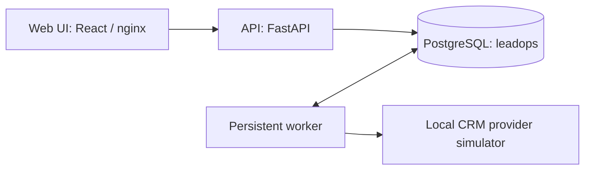

# EnquiryTrail

EnquiryTrail is a single-operator lead intake pipeline for a fictional
renovation company. An enquiry arrives, is deduplicated, routed to an
owner, prepared in the background, synced to a CRM contact, and tracked
as a local follow-up task. It is a synthetic demo system: do not enter
real customer data.

## What you can explore

- Normalize contact details, deduplicate submissions, and route enquiries
  to an owner with a local follow-up task.
- Prepare enquiries in a persistent background worker and sync contacts
  while preserving existing CRM fields.
- Recover from retryable failures and lost create responses; probe and
  resume a provider after an authentication block.
- Review enquiries, tasks, integration status, and an event timeline in
  the web UI, then record operator follow-up actions.
- Exercise extraction and fallback with fixture/template adapters and
  demonstrate controlled provider failures against the local simulator.

## Quick start

For the containerized demo, install and start Docker Desktop with Docker
Compose available. Local Python and Node.js installations are only needed
for host-side development and tests.

All command blocks below use **PowerShell** and start from the repository
root. Directory changes use `Push-Location` / `Pop-Location` to return there.

Create the local configuration once:

```powershell
Copy-Item .env.example .env
```

Edit `.env`: set `SESSION_SECRET` to a private random value and
`SEED_OPERATOR_PASSWORD` to a demo operator password of your choosing.
Keep the default `CRM_MODE=mock` for the local demo. There is no default
operator password; `.env` is untracked and must stay private.

Start the stack and check its status:

```powershell
docker compose up -d --build
docker compose ps -a
Invoke-RestMethod http://127.0.0.1:8080/api/v1/health/ready
```

The first build can take a few minutes. The `migrate` service runs
`alembic upgrade head` and the seed before `api` and `worker` start;
its successful exit is expected. The API never migrates on start-up.
If the readiness request runs before startup completes, retry it after
checking the service status.

| Entry point | Address |
| --- | --- |
| Web UI | [http://127.0.0.1:5173](http://127.0.0.1:5173) |
| API | [http://127.0.0.1:8080](http://127.0.0.1:8080) |
| API liveness | [GET /api/v1/health/live](http://127.0.0.1:8080/api/v1/health/live) |
| API readiness | [GET /api/v1/health/ready](http://127.0.0.1:8080/api/v1/health/ready) |

### First walkthrough

1. Open the web UI and sign in as `demo-operator`, using the password
   you set in `SEED_OPERATOR_PASSWORD`. If you changed
   `SEED_OPERATOR_USERNAME`, use that username instead.
2. Open **New quote**. Enter synthetic details such as first name `Demo`,
   email `demo-one@example.com`, service `kitchen`, and a project message
   of at least 20 characters. Check the synthetic-data acknowledgement
   and submit.
3. Follow **View enquiry status**, or find the enquiry in **Enquiries**.
   Wait for CRM status `synced` and the enquiry to reach
   `ready (attention: none)`. Inspect the assigned owner, follow-up task,
   and **Events** timeline.
4. Open **Tasks**, enter a reason of 10-500 characters, and complete the
   enquiry's follow-up. Select **Completed** and reload to confirm it
   remains completed.

For lost-response recovery, authentication blocking, and isolated demo
setup, see the [demo runbook](docs/demo-runbook.md).

## Architecture and delivery scope



Intake commits the receipt, contact, enquiry, owner assignment, follow-up
task, prepare job, and received event in one transaction. The worker
claims persisted jobs, prepares the enquiry, and schedules contact sync.
The UI reads the persisted results and supports operator actions through
the API.

The application lives in `backend/`, the React UI in `frontend/`, the
independent simulator in `provider-sim/`, and browser tests in `e2e/`.
Within the backend, dependencies flow from API to services to
domain/ports/database; adapters implement the ports. The product and
repository name is EnquiryTrail. Internal database, schema, package, and
test-database identifiers retain `leadops` to match the contract package.

| Delivery status | Capability |
| --- | --- |
| Implemented and verified locally | Mock CRM path against the provider simulator; fixture/template extraction. The default Compose stack uses the simulator. |
| Implemented but unverified against a real provider | HTTP CRM adapter implementing the [local wire contract](docs/crm-http-contract.md). |
| Not implemented | Live extractor for connected mode and real provider conformance. Selecting connected extraction fails explicitly. |
| Excluded from this delivery | Real HubSpot and real LLM calls. |

Connected mode remains **UNVERIFIED** and M0 remains open. Acceptance
verdicts remain **PENDING OPERATOR** until the operator signs them.
Simulator results do not establish real-provider behaviour. See the
[connected handover](docs/connected-handover.md) for the full classification
and remaining evidence requirements.

## Development and tests

Host-side prerequisites: Python 3.12 and `uv` for backend checks; Node.js
22 and npm for frontend and browser checks, matching CI. Integration tests
also need Docker Desktop. Complete the `.env` setup above before using
Compose, including when starting only the database.

Install dependencies from the lockfiles:

```powershell
Push-Location backend
uv sync --locked --python 3.12
Pop-Location
Push-Location frontend
npm ci
Pop-Location
```

### Backend

Unit tests need no database. Integration tests use PostgreSQL 16 on
`127.0.0.1:55432`; the harness reads `DATABASE_URL` from the environment
or the root `.env`. Keep it consistent with the Compose database settings.
The suite creates a throwaway `leadops_test_<hex>` database, applies the
Alembic migration, truncates between tests, and drops it afterwards. It
never touches the development database and never falls back to SQLite.

```powershell
Push-Location backend
uv run pytest tests/unit -q
uv run ruff check app tests
Pop-Location
docker compose up -d --wait db
Push-Location backend
uv run pytest tests/integration -q
Pop-Location
```

### Frontend

After installing frontend dependencies:

```powershell
Push-Location frontend
npm run lint
npm run test
npm run build
Pop-Location
```

### Browser tests

Start the full Compose stack as above. Replace the password placeholder
below with the seeded operator's password, and adjust the username if
customized. These host-side commands do not load credentials from `.env`.

```powershell
Push-Location e2e
npm ci
npx playwright install chromium
$env:E2E_USERNAME = 'demo-operator'
$env:E2E_PASSWORD = '<seed-operator-password>'
npm run test
Pop-Location
```

Without credentials the credential-gated specs fail rather than skip.
CI provides its own throwaway credentials so the suite runs in full.

### Live provider tests (opt-in)

These tests are for a dedicated real test account, never the simulator.
Set `CRM_MODE=http`, a real `CRM_BASE_URL` and `CRM_TOKEN`, and
`LIVE_TEST_ACCOUNT_MARKER` in the current process environment first.
The live suite does not load those values from `.env`.

```powershell
Push-Location backend
uv run pytest tests/live --run-live -q
Pop-Location
```

Missing prerequisites cause explicit failures naming each missing item.
This suite exercises the HTTP adapter directly; it does not verify the
full intake/worker flow or close A30. Its real-provider happy path has
not been run in this delivery; see the connected handover.

Changes follow the [development process](docs/development-process.md):
test first for behaviour changes, with green CI on the exact commit that
lands as the merge gate. Local checks do not replace that gate.

## Troubleshooting and stopping

Inspect service status and recent startup/worker logs:

```powershell
docker compose ps -a
docker compose logs --tail 100 migrate api worker
```

- **Compose rejects configuration:** set both `SESSION_SECRET` and
  `SEED_OPERATOR_PASSWORD` in `.env`; even database-only commands require
  them because Compose validates the full configuration.
- **Sign-in fails after changing `.env`:** the seed creates an operator
  only when absent. Re-running it does not reset an existing password.
- **Browser requests are rejected:** use `http://127.0.0.1:5173` as shown.
  If you change the UI origin, configure that exact origin in
  `ALLOWED_ORIGINS`; `localhost` and `127.0.0.1` are different origins.
- **Enquiry sync stalls:** inspect worker logs and the **Integrations**
  page. The [recovery runbook](docs/connected-handover.md) covers worker
  heartbeat checks, provider probing/resume, and job retry.

Stop the stack while retaining its database volume:

```powershell
docker compose down
```

## Documentation

- [Demo walkthrough and failure scenarios](docs/demo-runbook.md)
- [Connected handover and recovery runbook](docs/connected-handover.md)
- [CRM HTTP wire contract](docs/crm-http-contract.md)
- [Development process and merge gate](docs/development-process.md)
- [Acceptance log](docs/acceptance-log.md)
- [Checklist](docs/checklist.md)
- [Agent guide](AGENTS.md)
